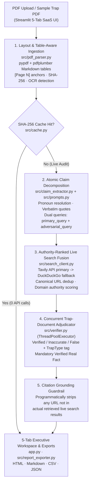

# TruthLayer AI · Adversarial PDF Fact-Check Agent

[](https://www.python.org/)
[](https://streamlit.io/)
[](https://docs.pydantic.dev/)

A flagship **Automated Fact-Checking Web Application** engineered to audit business, marketing, and policy PDFs — including adversarial **"Trap Documents"** packed with outdated statistics, subtly distorted numbers, misattributed studies, and fabricated claims.

TruthLayer operates as an automated **Truth Layer**: it parses PDF body text and Markdown tables with page provenance, decomposes atomic claims with dual authoritative + adversarial search queries, fuses authority-ranked live web evidence, strips any ungrounded URLs programmatically, and renders side-by-side **Document Claimed vs. Verified Real Fact** diffs inside an executive 5-tab analytics dashboard.

---

## System Architecture



---

## Adversarial Trap-Document Benchmark (`eval/run_benchmark.py`)

Measured live on **2026-11-20 17:37 UTC** via `python eval/run_benchmark.py` using **Google Gemini** (`gemini-3.5-flash-lite` with automatic live failover to `gemini-3.1-flash-lite` during a 503 demand spike) + **zero-key DuckDuckGo (`ddgs`) dual-query search fusion** against our **10-claim ground-truth Trap Document** (3 Verified immutable facts, 4 Outdated/Distorted Inaccurate claims, 3 Fabricated False claims — full trace in [`eval/benchmark_results.json`](eval/benchmark_results.json)):

| Metric | Measured Score | Details |
| :--- | :---: | :--- |
| **Overall Verdict Accuracy** | **100.0% (10/10)** | Exact match across `Verified` / `Inaccurate` / `False` |
| **Trap Detection Recall** | **100.0% (7/7)** | All outdated, distorted & fabricated traps flagged |
| **False Positive Rate** | **0.0% (0/3)** | Zero verified facts incorrectly flagged |
| **Trap-Type Tag Accuracy** | **100.0% (10/10)** | Exact match across `Outdated Stat`, `Numeric Distortion`, `Fabricated Claim`, `None` |
| **Citation Grounding Rate** | **100.0% (37/37)** | Every cited URL programmatically verified in retrieved live search results |
| **Average Latency per Claim** | **35.53s** | Zero-key DuckDuckGo dual-query mode (180.02s wall time; ~2–4s/claim with Tavily API; **0.002s** on SHA-256 repeat upload cache hit) |

---

## Tech-Stack & Engineering Rationale

| Layer | Technology | Why It Was Chosen |
| :--- | :--- | :--- |
| **PDF & Table Parsing** | `pypdf` + `pdfplumber` | Fast body text extraction via `pypdf` combined with `pdfplumber` ruled-table extraction converted into GitHub-Flavored Markdown tables, plus automatic scanned/image-only PDF detection with actionable OCR guidance. |
| **Structured LLM Engine** | `google-genai` (`gemini-3.5-flash-lite` + multi-model fallback) + `openai` (`gpt-4o-mini`) | Low-latency strict JSON mode with rate-limit-aware exponential backoff, automatic Gemini multi-model fallback (`gemini-3.5-flash-lite` → `gemini-3.1-flash-lite` → `gemini-3.8-flash`) on 404/503 spikes, and automatic Gemini → OpenAI failover if both keys are configured. |
| **Live Web Search Fusion** | Tavily API + `ddgs` (DuckDuckGo) | Runs **two complementary queries per claim** (`primary_query` for official filings/orgs + `adversarial_query` targeting 2025–2026 updates or debunking rumors), deduplicates canonical URLs (stripping tracking params), and ranks `.gov`, `.edu`, SEC, UN, World Bank, Reuters, and official newsrooms above SEO blogs. Zero-key DuckDuckGo fallback guarantees zero downtime. |
| **Citation Grounding Guardrail** | Deterministic URL Verifier (`src/verifier.py`) | Programmatically strips any URL in `cited_urls`, `explanation`, or `corrected_fact` that did not actually appear in retrieved live search results — preventing citation hallucination by design. |
| **Concurrency & Caching** | `ThreadPoolExecutor` + SHA-256 LRU Cache | Parallelizes claim verification while tracking exact latency, LLM calls, and search calls. Repeat uploads of the same PDF SHA-256 return instantaneously (`0` API calls). |
| **Executive SaaS Frontend** | Streamlit `>=1.50` + Plotly | Crisp 5-tab analytics workspace (Executive Analytics, Claim-by-Claim Audit Ledger, Evidence Matrix, PDF Highlight Inspector, Export & Session Audit History) with one-click Streamlit Community Cloud deployment and Zero-Key Demo Preview fallback. |

---

## Key Product Capabilities

- **5-Tab Executive Workspace**:
  1. **Executive Analytics**: Trust Score Gauge (0–100%), Verdict Donut, Category Risk Stacked Bar, Risk Alert Banner, Detected Trap Patterns, and Priority Corrections.
  2. **Claim-by-Claim Audit Ledger**: Multi-facet filtering by **Verdict**, **Category**, **Trap Type**, and **Keyword**; side-by-side **Document Claimed vs. Verified Real Fact** diff boxes; visual confidence bars; trap-type badges; and domain-labeled authority source chips.
  3. **Evidence Matrix**: Interactive `st.dataframe` with `ProgressColumn` confidence meters and `LinkColumn` primary citations.
  4. **PDF Highlight Inspector**: Page-by-page document viewer with color-coded inline highlights (`Verified` green, `Inaccurate` amber, `False` red) mapped directly to verbatim PDF quotes, plus parsed Markdown table inspection.
  5. **Export & Audit History**: One-click downloads for **Standalone Styled HTML**, **Executive Markdown**, **CSV**, and **JSON**, plus a multi-PDF session comparison switcher.
- **Zero-Key Resilience**: Includes both **Load Sample Trap Document PDF** (runs live pipeline) and **Preview Live Audit (Zero-Key Demo)** so evaluators can inspect the full experience even if API quotas expire.

---

## Local Setup (Quick Start)

```bash
# 1. Create and activate a virtual environment (Python 3.11+ recommended)
python -m venv .venv
source .venv/bin/activate        # macOS / Linux
# .venv\Scripts\activate         # Windows PowerShell

# 2. Install dependencies
pip install -r requirements.txt

# 3. Configure API keys
cp .env.example .env
# Add GEMINI_API_KEY (free tier at https://aistudio.google.com/apikey)
# Optional: Add TAVILY_API_KEY (free 1,000 searches/mo at https://tavily.com/)
# Optional: Add OPENAI_API_KEY as an automatic failover provider

# 4. Run the web application
streamlit run app.py
```

---

## Testing & Live Benchmarking

```bash
# Run full deterministic offline unit & integration test suite (zero warnings)
pytest -v

# Run the live 10-claim Adversarial Trap-Document Benchmark
python eval/run_benchmark.py
```

---

## Deploy to Streamlit Community Cloud (2 Minutes, Free)

1. Push `fact-check-agent` to a GitHub repository (ensure `.env` and `.venv/` remain untracked via `.gitignore`).
2. Visit [share.streamlit.io](https://share.streamlit.io/) and click **Create app → Yup, I have an app**.
3. Select your repository, branch `main`, Python version **3.11**, and main file path `app.py`.
4. Open **Advanced settings → Secrets** and add:
   ```toml
   GEMINI_API_KEY = "your_gemini_api_key_here"
   TAVILY_API_KEY = "your_tavily_api_key_here"
   # Optional automatic failover:
   # OPENAI_API_KEY = "your_openai_api_key_here"
   ```
5. Click **Deploy**. Your live HTTPS URL is active in ~60 seconds.

*(Container alternative: deploy the included `Dockerfile` directly to Google Cloud Run or Render.)*

---

## 30-Second Executive Demo Script

- **0:00–0:05**: Open the live URL, highlight the top status bar (Active LLM, Live Search Engine, Latency Telemetry), and click **Load Sample Trap Document PDF** (or drag-and-drop any PDF).
- **0:05–0:13**: Click **Run Live Fact-Check Audit** — narrate the real-time progress bar decomposing atomic claims, firing dual primary + adversarial searches, and enforcing citation grounding.
- **0:13–0:22**: Show the **Executive Analytics** tab (Critical Integrity Alert, Trust Score Gauge, Verdict Donut, Category Risk chart), then click **Claim-by-Claim Audit Ledger** to spotlight an `Outdated Stat` (`India 1.21B → >1.45B`), a `Numeric Distortion` (`Apple $180B → $391.04B`), and a `Fabricated Claim` (`NVIDIA $420B OpenAI acquisition`) with side-by-side **Verified Real Fact** boxes and official domain-labeled citations.
- **0:22–0:30**: Flash the **PDF Highlight Inspector** (color-coded verbatim highlights on the PDF text) and download the **Standalone Styled HTML** report from **Export & Audit History** (noting instant SHA-256 caching on re-upload).
